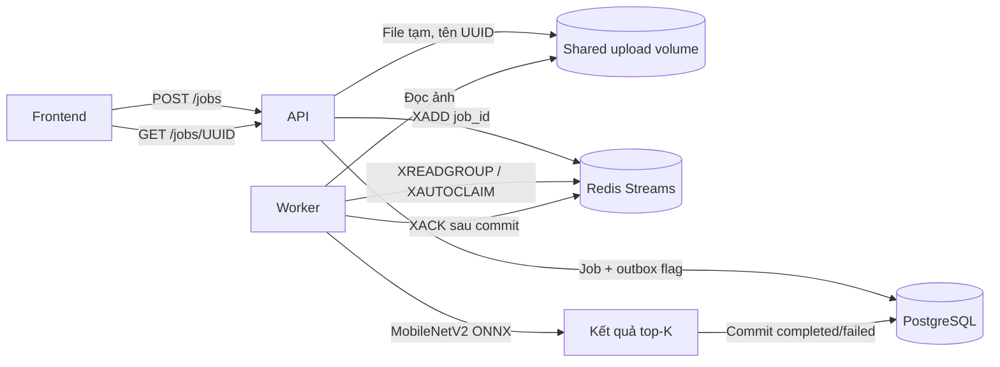

# Luồng xử lý và lưu trữ TV2

API không chạy mô hình. Redis message chỉ chứa `job_id`; worker đọc đường dẫn
nội bộ từ PostgreSQL và lấy file trong volume dùng chung. Cấu hình `UPLOAD_DIR`
có thể khác đường dẫn giữa máy/container, miễn là trỏ tới cùng dữ liệu.

## Schema đầu tiên

Bảng `jobs` được định nghĩa trong `backend/app/models.py`.
Chạy `python -m backend.app.init_db` để tạo schema (Compose tự chạy db-init).
Đây là schema ban đầu; thay đổi schema sau này cần migration có phiên bản.

| Nhóm trường | Nội dung |
|---|---|
| id | UUID dạng chuỗi, primary key |
| status | queued / processing / completed / failed, có check constraint và index |
| content_type, size_bytes, width, height | Metadata ảnh đã kiểm tra |
| image_path | Tên file UUID trong volume; chuyển null sau khi dọn file |
| published | Outbox flag, index; false khi chưa xác nhận phát Redis |
| lease_token, lease_until | Quyền xử lý và thời điểm hết hạn, dùng cập nhật có điều kiện |
| predictions, error | JSON top-K hoặc lỗi công khai |
| model_version, model_sha256 | Phiên bản và checksum thực tế đã suy luận |
| created_at, updated_at | Timestamp UTC |

PostgreSQL không lưu byte ảnh, tên file gốc, EXIF, thông tin tài khoản hay IP
người upload. File ảnh gốc chỉ lưu tạm trên volume khi đang chờ/xử lý.
Worker xóa file sau kết quả cuối cùng; nếu xóa tạm lỗi, vòng sau thử lại.
Các job và kết quả được giữ cho đến khi nhóm áp dụng chính sách dọn dữ liệu.

## Độ tin cậy

- Lưu file và commit job trước khi trả 202.
- Bản ghi queued có `published=false` đóng vai trò outbox. API thử phát ngay;
  mỗi vòng worker phát tiếp các bản ghi còn chờ. Redis tạm lỗi không làm mất job đã nhận.
- `SELECT FOR UPDATE SKIP LOCKED` phối hợp nhiều dispatcher trên PostgreSQL.
  XADD thành công nhưng DB chưa commit có thể tạo message trùng; đó là delivery
  at least once, không giả định exactly once.
- Consumer group bắt đầu từ `0-0`, đọc message mới bằng XREADGROUP.
- Worker chỉ nhận quyền bằng UPDATE có điều kiện. Lease đang còn hiệu lực
  ngăn worker khác chạy cùng job. Kết quả chỉ được commit nếu lease token còn đúng.
- Kết quả completed/failed không bị xử lý lại. ACK chỉ thực hiện sau commit;
  sau ACK, XDEL message để giảm dữ liệu stream (chỉ hỗ trợ một consumer group).
- XAUTOCLAIM nhận lại pending message khi worker chết, sau JOB_LEASE_SECONDS.
  Hết lease trong lúc suy luận rất lâu có thể gây tính toán trùng; chỉ worker
  giữ token mới nhất được ghi kết quả.
- Redis dùng AOF với appendfsync always và named volume. Không xóa Redis volume
  độc lập với PostgreSQL khi còn job; mất toàn bộ dữ liệu Redis ngoài phạm vi
  phục hồi pending/outbox hiện tại.
- Nếu tiến trình API chết giữa ghi file và commit DB, có thể còn file mồ côi.
  Đây là giới hạn của lưu file local; không tự quét/xóa file của tác vụ đang chạy.

Ảnh được phân loại bằng model có sẵn, không được dùng để train thêm.

## Model và phiên bản

Dùng **MobileNetV2, ONNX opset 7**, 1000 lớp ImageNet, CPUExecutionProvider.
Nguồn và giấy phép được xác nhận tại
[ONNX Model Zoo](https://github.com/onnx/models/tree/c5cae0f1942c8d7727372c7b1f6b485aa39e4421/validated/vision/classification/mobilenet).
Giấy phép **Apache-2.0**. Script tải kèm bản LICENSE vào thư mục model.

`models/manifest.json` cố định commit nguồn và SHA256 của model, nhãn, LICENSE.
Script tải vào file .part, kiểm tra hash rồi mới thay artifact đích.
Worker kiểm tra checksum model và nhãn khi khởi động; sai checksum sẽ không chạy.
Không commit file ONNX lớn. Compose tải vào named volume; cách native tải vào models/.

Tiền xử lý: áp EXIF orientation, RGB, cửa sổ giữa 224/256 cạnh ngắn,
nội suy bilinear về 224×224, chia 255, chuẩn hóa mean [0.485, 0.456, 0.406],
std [0.229, 0.224, 0.225], tensor float32 NCHW.
Crop và resize được gộp để tránh ảnh trung gian lớn với tỷ lệ bất thường.
Sau inference: softmax ổn định và top-K theo
[hướng dẫn mô hình gốc](https://github.com/onnx/models/blob/c5cae0f1942c8d7727372c7b1f6b485aa39e4421/validated/vision/classification/mobilenet/README.md).

Phiên bản ứng dụng mặc định: `mobilenetv2-7-v1`.
SHA256 model: `c1c513582d56afceff8516c73804e484c81c6a830712ab6d682253f4a3cd042f`.
Muốn đổi model: cập nhật manifest, version, hash/model path/labels path trong
cấu hình, test lại và rebuild worker. Mỗi kết quả lưu model version/hash để truy vết.
Chỉ đổi MODEL_VERSION không làm thay đổi trọng số.

## Log và metrics

Log ứng dụng và Uvicorn là từng dòng JSON ra stdout, gồm timestamp UTC,
level, service, logger, message; thêm job_id hoặc request_id khi có.
Không ghi file ảnh, tên gốc, nội dung exception hay URL kết nối.
HTTP metrics dùng route mẫu `/jobs/{job_id}`, tránh label tăng theo UUID.

Prometheus scrape: `api:8000/metrics` và `worker:8001/metrics` trong mạng Compose,
hoặc localhost:8000 và localhost:8001 trên máy. Bộ collector dùng riêng mỗi service;
chạy một process/container. Job counters tính từ lần khởi động service.

Tham khảo giao thức Redis:
[XREADGROUP](https://redis.io/docs/latest/commands/xreadgroup/),
[XAUTOCLAIM](https://redis.io/docs/latest/commands/xautoclaim/).
